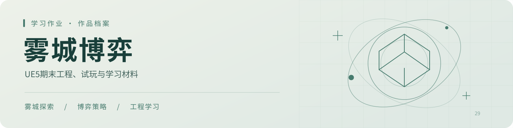
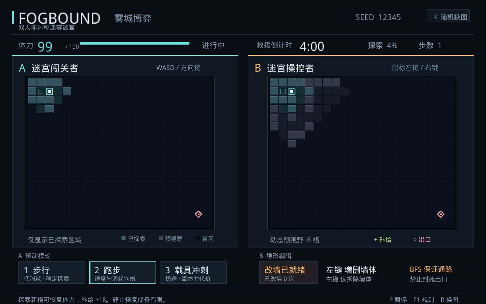

<!-- project-showcase:start -->
<p align="center"></p>
<p align="center"><b>雾城探索 · 博弈策略 · 工程学习</b></p>
<p align="center"><a href="#作品画面">看作品</a>　 ·　 <a href="ITERATION_HISTORY.md">历次迭代</a>　 ·　 <a href="https://github.com/qiuyimei/fogbound-ue5-learning/archive/refs/heads/main.zip">下载源码</a>　 ·　 <a href="https://github.com/qiuyimei/project-collection#作品图录">全部作品</a></p>

**雾城博弈** · UE5期末工程、试玩与学习材料。

## 作品画面

<p align="center"><a href="docs/showcase/preview-01.png"></a><br/><sub>游戏试玩画面</sub></p>

## 从这里开始

| 想做什么 | 入口 |
| --- | --- |
| 查看每次迭代、日期与改动 | [历史版本目录](ITERATION_HISTORY.md) |
| 下载当前完整源码 | [当前版本 ZIP](https://github.com/qiuyimei/fogbound-ue5-learning/archive/refs/heads/main.zip) |
| 下载发布包、查看已有附件 | [Releases 发布页](https://github.com/qiuyimei/fogbound-ue5-learning/releases) |
| 浏览当前工程 | [仓库文件](.) |

<!-- project-showcase:end -->

---

## 使用与项目说明

# 雾城博弈 Fogbound

UE 5.8.4 纯蓝图的同机双人迷雾迷宫，以及配套的中文学习文件。A 使用键盘探索，B 使用鼠标修改墙体；每次改墙都用 BFS 检查到出口的通路。



## 先从这里开始

1. **试玩**：[下载 Windows 版](https://github.com/qiuyimei/fogbound-ue5-learning/releases/latest)，完整解压后运行 `Windows/Fogbound.exe`。
2. **学习**：双击 `Learning/离线学习.html`。页面不需要联网，含双视图迷雾、BFS 改墙实验、DFS 单步演示和真实蓝图节点索引。
3. **阅读手册**：[中文 Word 学习手册](Learning/雾城博弈学习手册.docx)。
4. **编辑工程**：使用 UE 5.8 打开 [Fogbound/Fogbound.uproject](Fogbound/Fogbound.uproject)。已在 5.8.4 验证；旧版引擎不保证可打开。

完整学习包、工程包与 Windows 试玩包均放在 [Releases](https://github.com/qiuyimei/fogbound-ue5-learning/releases)。大体积运行程序不进入 Git 提交历史。

## 操作

| 操作方 | 按键或鼠标 | 效果 |
| --- | --- | --- |
| A 闯关者 | WASD 或方向键 | 按网格移动 |
| A 闯关者 | 1、2、3 | 步行、跑步、载具冲刺模式 |
| B 操控者 | 右侧地图左键 | 增删墙体 |
| B 操控者 | 右侧地图右键 | 仅拆墙 |
| 双方 | 空格或 Enter | 开始、继续或同图再战 |
| 双方 | P、F1、R | 暂停、规则、随机换图 |
| 双方 | Alt + F4 | 退出独立游戏窗口 |

## 学习文件

| 路径 | 内容 |
| --- | --- |
| `Fogbound/Content/Blueprints/Core/BP_MazeCore.uasset` | 随机迷宫、资源、探索、BFS、改墙事务、胜负 |
| `Fogbound/Content/Blueprints/UI/BP_FogboundHUD.uasset` | Canvas 界面、键鼠输入和两个权限视图 |
| `Learning/雾城博弈学习手册.docx` | 分章节讲解、参数、练习和参考答案 |
| `Learning/学习指南.md` | 便于在 GitHub 直接阅读的教程 |
| `Learning/离线学习.html` | 无依赖的交互学习页 |
| `Learning/Data/blueprint_catalog.json` | 从实际 UE 资产导出的变量、图、节点、引脚和连线 |
| `Learning/Data/ue_seed_samples.json` | 八组真实 UE 随机种子地图 |
| `Tools/generate_blueprints.py` | 中文注释的蓝图生成源码；只用于编辑器阶段 |
| `Tools/Run-Generate.ps1` | 在全新沙盒中生成工程，并运行验证 |
| `Tools/Run-Verify.ps1` | 编译、规则测试、目录导出 |
| `Reference/maze_reference.py` | 标准库版算法模型，支持终端迷宫和路径输出 |
| `Reference/test_reference.py` | 教学模型的独立验证 |

## 运行教学模型

在仓库根目录使用 Python 3.10 或更高版本：

```powershell
python Reference/maze_reference.py --seed 12345 --solution
python -m unittest discover -s Reference -v
```

也可以用 Node.js 验证离线页所使用的 JavaScript 算法：

```powershell
node Reference/test_javascript.cjs
```

这些模型帮助理解算法，不代替 UE 运行。随机公式与调用顺序已用八组 UE 导出样本逐格核对；改引擎版本或改变蓝图随机节点的求值顺序后，需要重新核对。

## 从源码生成练习副本

关闭正在编辑的练习副本，在 PowerShell 中运行：

```powershell
./Tools/Run-Generate.ps1 -EngineRoot "D:/UnrealEngine/UE_5.8"
```

默认创建新的 `Sandboxes/FogboundStudy_时间/`，不会覆盖现有工程。生成器需要 UE 自带的 Python Script Plugin 与 Editor Scripting Utilities。Python 只在编辑器生成和测试阶段使用，成品游戏没有 Python 或 C++ 游戏模块依赖。

验证已有的练习工程：

```powershell
./Tools/Run-Verify.ps1 -EngineRoot "D:/UnrealEngine/UE_5.8"
```

该命令会编译并重新保存蓝图；测试状态只写入内存，结束后恢复。结果位于工程的 `Saved/StudyReports/`。

## 当前实现范围

这是 **同机、同屏、俯视二维网格版**。两个面板在显示器上都可见，角色权限分别计算；没有网络联机、独立屏幕保密或三维驾驶载具。“载具冲刺”表现为移动速度、消耗和图标变化。界面使用 Canvas，不是 UMG 控件树。

地图固定为 21×17。尺寸、画布位置和部分提示文字存在配套常量，修改时须一起调整。完整游戏更新目前由 `ReceiveDrawHUD` 调度；本仓库不把它描述为生产级联机架构。

## 验证与出处

原工程通过 23 项 Blueprint VM 规则检查及 7 项界面检查；Win64 打包程序启动、中文字体与角色移动已验证。原始报告保存在 `Fogbound/Docs/`。新增源码复现与教学模型检查见 `Learning/Data/学习包验证.json`。

教程根据本项目的实际资产与源码编写。UE 编辑器脚本 API 的官方入口见 [BlueprintEditorLibrary](https://dev.epicgames.com/documentation/unreal-engine/API/Editor/BlueprintEditorLibrary) 和 [Python 编辑器脚本说明](https://dev.epicgames.com/documentation/en-us/unreal-engine/scripting-the-unreal-editor-using-python)。

运行项目使用 Unreal Engine；字体来自引擎随附的 Droid Sans Fallback，相关说明见 [ThirdParty](ThirdParty/README.md)。本仓库未额外指定项目开源许可证。

